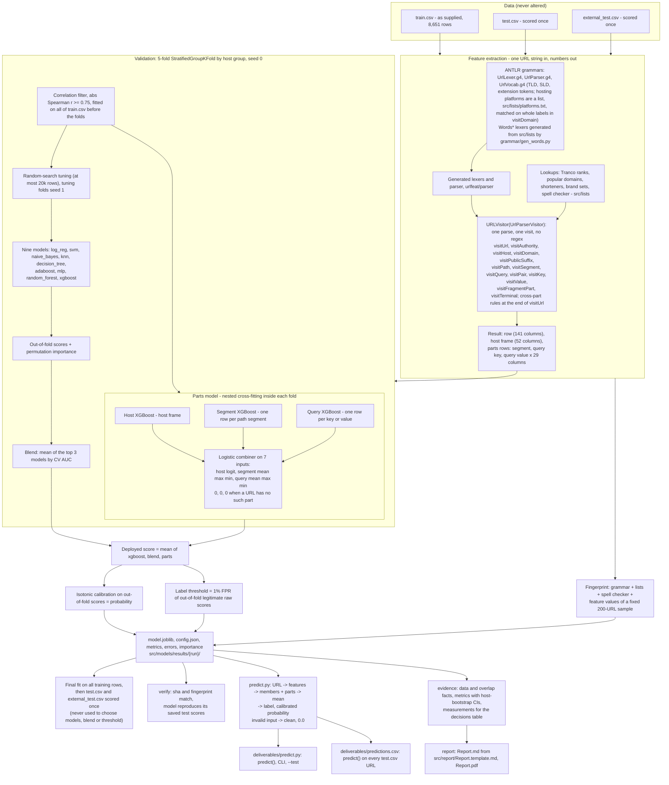
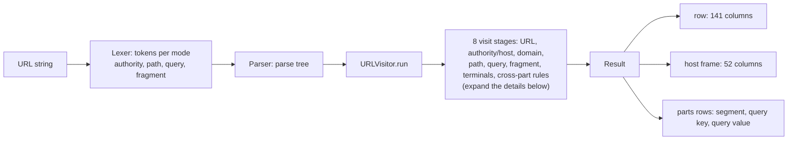
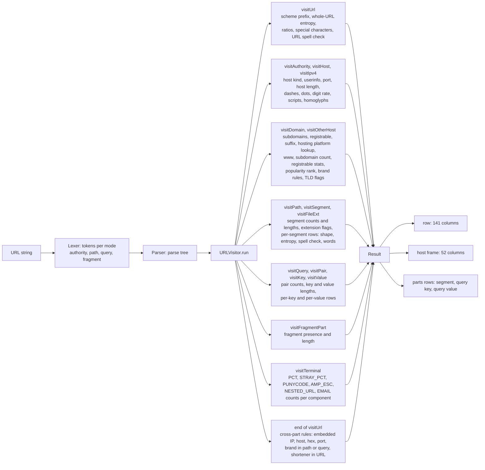

# <b>P</b><small><small><i>hishing</i></small></small> <b>ML</b>

*URL-only phishing classifier*

Classifies a single URL string as `phishing` or `clean`, using only the URL text (no page content, no network lookups).
Every URL is parsed by an ANTLR grammar; one visit of the parse tree yields 141 features, which feed an ensemble of
gradient-boosted trees, a multilayer perceptron, a random forest and a per-part model. Method and results: [`Report.md`](Report.md) ([PDF](Report.pdf)).

## Requirements
* Python 3.11 or newer (developed on 3.14); dependencies are pinned in `requirements.txt`.
* For prediction nothing else is needed: no Java, no network access. The trained model ships in `src/models/results/` (the run named in `src/models/results/LATEST`).
* Optional: `pandoc` (3.6+) and `xelatex` (TeX Live 2023+) to rebuild `Report.pdf`; Java 11+ to regenerate the ANTLR parser after editing the grammar.

## Installation
```bash
git clone git@github.com:TamasSmahajcsikszabo/PML.git phishing_ML
cd phishing_ML
python -m venv .venv
source .venv/bin/activate             # Windows: .venv\Scripts\activate
pip install -r requirements.txt
```

The supplied data files are **not** part of the repository. They are needed only for training and evaluation, not for prediction:
```bash
mkdir -p data
cp /path/to/train.csv /path/to/test.csv /path/to/external_test.csv data/
```

Check the installation (loads the saved model and runs 33 valid and invalid inputs through `predict`; a few seconds):
```bash
PYTHONPATH=src python src/tests/test_predict_contract.py     # expected: "33 inputs, 0 failures"
```

## Usage

`predict(url)` takes any string and returns a dictionary with exactly two keys:

| key | value |
|---|---|
| `label` | `"phishing"` or `"clean"` |
| `probability` | calibrated phishing probability in [0, 1] |

The model is loaded on first use; nothing is trained or downloaded. The entry point is `deliverables/predict.py`, which finds the code and the model by itself, so no path setup is needed.

### Python
```python
>>> import sys; sys.path.insert(0, "deliverables")      # or run Python from inside deliverables/
>>> from predict import predict
>>> predict("https://www.wikipedia.org/")
{'label': 'clean', 'probability': 0.00391304347826087}
>>> predict("https://docs.python.org/3/library/json.html")
{'label': 'clean', 'probability': 0.022556390977443608}
>>> predict("https://www.PayPal-secure.login.tk/webscr?cmd=x")
{'label': 'phishing', 'probability': 0.9921259842519685}
>>> predict("http://paypal.com.account-verify.secure-login.xyz/webscr/update.php?cmd=_login")
{'label': 'phishing', 'probability': 0.9996756406097956}
```

### Command line
One JSON line per URL:
```console
$ python deliverables/predict.py "https://www.wikipedia.org/" "https://www.PayPal-secure.login.tk/webscr?cmd=x"
{"url": "https://www.wikipedia.org/", "label": "clean", "probability": 0.00391304347826087}
{"url": "https://www.PayPal-secure.login.tk/webscr?cmd=x", "label": "phishing", "probability": 0.9921259842519685}
```

| option | effect |
|---|---|
| `--vote URL ...` | every model in the ensemble votes at its own threshold; majority label, calibrated probability and the individual votes |
| `--best URL ...` | only the best single model (XGBoost): its raw probability and label |
| `--test [-n 50] [--seed 1]` | scores a random sample of unseen URLs from a public dataset and saves the results to `deliverables/results/` |

`--vote` and `--best` combine with `--test` and are mutually exclusive. With `--vote`, `label` is the majority of the four models (XGBoost, MLP, random forest, parts model, each at its own 1%-FPR threshold), `probability` is the calibrated ensemble probability, and `votes` lists each model's label and raw probability. With `--best`, the raw (uncalibrated) XGBoost probability and its label are returned, plus `"model"`.

### `--test` sample data
`deliverables/data/unseen_pool.csv` (5,000 URLs: 1,000 phishing, 4,000 neutral; columns `url,label`, 1 = phishing) is a seeded random subset of the Kaggle dataset
[taruntiwarihp/phishing-site-urls](https://www.kaggle.com/datasets/taruntiwarihp/phishing-site-urls) (549,346 URLs; Open Database License, ODbL; the "D1" set of Jalil et al. 2023).
Before sampling, every URL whose normalised form (lower case, no scheme, no leading `www.`, no trailing slash) appears in `train.csv` (434 URLs), `test.csv` (140) or `external_test.csv` (13) was removed, as were URLs with conflicting labels and duplicates (501,069 unique left).
Hosts still overlap: 3.9% of phishing and 27.3% of neutral pool rows share a registrable domain with the supplied sets. Provenance: `deliverables/data/unseen_pool.json`; rebuild with `PYTHONPATH=src python src/tools/build_unseen_pool.py phishing_site_urls.csv`.

Each `--test` run draws `-n` URLs (default 50): ceil(5% of n) phishing (3 for 50), the rest neutral; `--seed` makes the draw repeatable.
The URLs have **no scheme** and are scored exactly as written. "Neutral" means ordinary pages, and 50 URLs are too few to estimate rates.
On the whole pool at the deployed threshold: AUC 0.983, recall 0.76, false-positive rate 0.6%, precision 0.97 at the pool's 20% phishing share. The pool's source is one of the public collections in the training data, but none of its URLs was trained on.

Every run writes `deliverables/results/test_<timestamp>_n<N>_seed<S>.csv` (`url,truth,prediction,probability,correct`) and a `.json` with the counts, seed, threshold and model run.
Analyse them with `PYTHONPATH=src python -m tools.error_analysis deliverables/results/<file>.csv`.

### Interpreting the output
* A URL is labelled `phishing` when its calibrated probability is above about 0.944, the score reached by 1% of the legitimate training URLs (out of fold).
* The probability refers to a population that is half phishing, like the training data, not to real traffic, where phishing is far rarer. Use the output to warn or rank, not to block.
* Invalid input (not a string, empty, longer than 8,192 characters, or not readable as a URL) returns `{"label": "clean", "probability": 0.0}`, meaning "no evidence", not "safe".

The outputs above come from the delivered model (run `v3_20261109T1148_parts-train-extra4`).

## Development
The training, test and analysis scripts import from `src/`; set the path once per shell:
```bash
export PYTHONPATH=src
```
```bash
python src/pipeline.py                  # reproduce everything (~30 min on CPU):
#   tests -> features -> train -> verify -> promote -> smoke -> evidence -> predictions -> report
#   writes src/models/results/{runID}/, deliverables/predictions.csv, docs/report/*.json, Report.md, Report.pdf
python src/pipeline.py --only report    # rebuild Report.md / Report.pdf from the last run (after report-only edits)

# single checks (all are also stages of the pipeline)
python src/grammar/check_grammar.py         # grammar, word lexers and visitor assertions
python src/tests/test_features.py           # one test per feature column on URLs built from known components
python src/tests/test_predict_contract.py   # predict() on invalid and unusual inputs
python -m tools.check_visitor               # visitor vs the frozen earlier extractor (the tests stage builds the oracle if missing)
```

Regenerating the parser after a grammar change (the ANTLR 4.13.2 jar is in `src/grammar/`):
```bash
cd src/grammar
java -jar antlr-4.13.2-complete.jar -Dlanguage=Python3 -visitor -no-listener -Xexact-output-dir -o ../urlfeat/parser UrlLexer.g4 UrlParser.g4
python gen_words.py                         # word-list lexers, after editing src/lists/
```

## Pipeline

Every URL is parsed once by ANTLR and visited once by `urlfeat.visitor.URLVisitor` (a child of the visitor generated from `UrlParser.g4`); that single visit builds the 141 full-URL columns, the host frame and the rows of the path segments / query keys / query values. No regular expressions: patterns are tokens of the grammars (`UrlLexer.g4`, the generated `Words*` word-list lexers) or scanners in `urlfeat/text.py`. Plan and decisions: `docs/plan_url_visitor.md`; equivalence with the previous extractor: `docs/analysis/visitor_agreement.md`.



### Where the visitor puts each kind of feature



<details>
<summary>Show the visit methods and the features each one builds</summary>



</details>

## Layout
| path | what |
|---|---|
| `src/urlfeat/` | features: `visitor.py` (`URLVisitor`: one ANTLR visit builds the 141 columns, the host frame and the parts rows), `text.py` (regex-free scanners), `wordlists.py` (lookups + the generated word lexers), `readability.py` / `obfuscation.py` / `popularity.py` (pure helpers: spelling, look-alike characters, Tranco rank), `fingerprint.py`, `__init__.py` (re-exports the visitor's entry points `featurize`, `extract`, `tables`, `structure`). The visitor is the single entry point for parsing and feature building (column groups, host-label aggregates and the batch methods are in `visitor.py`; the other modules are pure helpers it imports) |
| `src/grammar/`, `src/urlfeat/parser/` | ANTLR grammars + `antlr-4.13.2-complete.jar` (same SHA-256 as url_grammar's), `gen_words.py` (word-list lexers from `src/lists/`), `check_grammar.py`; the generated Python lexers / parser / visitor (do not edit) |
| `src/lists/` | word lists; provenance in `CLAUDE.md` and in each file's header |
| `common.py` | cleaning, host grouping, paths |
| `src/models/model.py`, `src/models/run.py`, `src/models/parts_model.py`, `src/models/run_parts.py`, `src/pipeline.py` | the nine classifiers + search spaces; training / CV / importance / results writer; the parts model and its combination with the nine; the staged pipeline (features, train, verify) |
| `deliverables/` | `predict.py` CLI/library required by the task (`--test` runs 50 unseen URLs from a Kaggle dataset); see its README |
| `deliverables/predictions.csv` | `url,probability` for every `test.csv` row, written by calling `predict()` on each URL of the promoted run; `Report.md` is the report |
| `src/models/results/{runID}/` | metrics, feature importances, OOF predictions, config, deployable model |
| `src/predict.py`, `src/common.py` | single-URL prediction (`from predict import predict`); paths, host grouping, task normalisation |
| `src/tools/` | report and evidence tools (`data_report`, `report_numbers`, `evidence`, `write_predictions`, `build_report`, `build_report_pdf`), checks (`check_visitor`, `legacy_oracle` + the frozen `legacy_urlfeat`), analyses (`error_analysis`, `compare_runs`, `antlr_reliance`, `scheme_gap`, `collinearity`, `second_stage_experiment`, `feature_table`, `explain_url`, `export_parts`), data builders (`build_corpus`, `build_unseen_pool`, `score_u`) |
| `scripts/`, `logs/` | shell scripts; logs of earlier runs |
