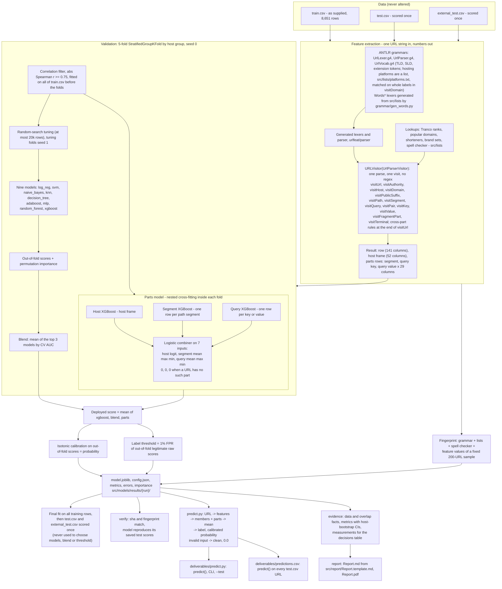
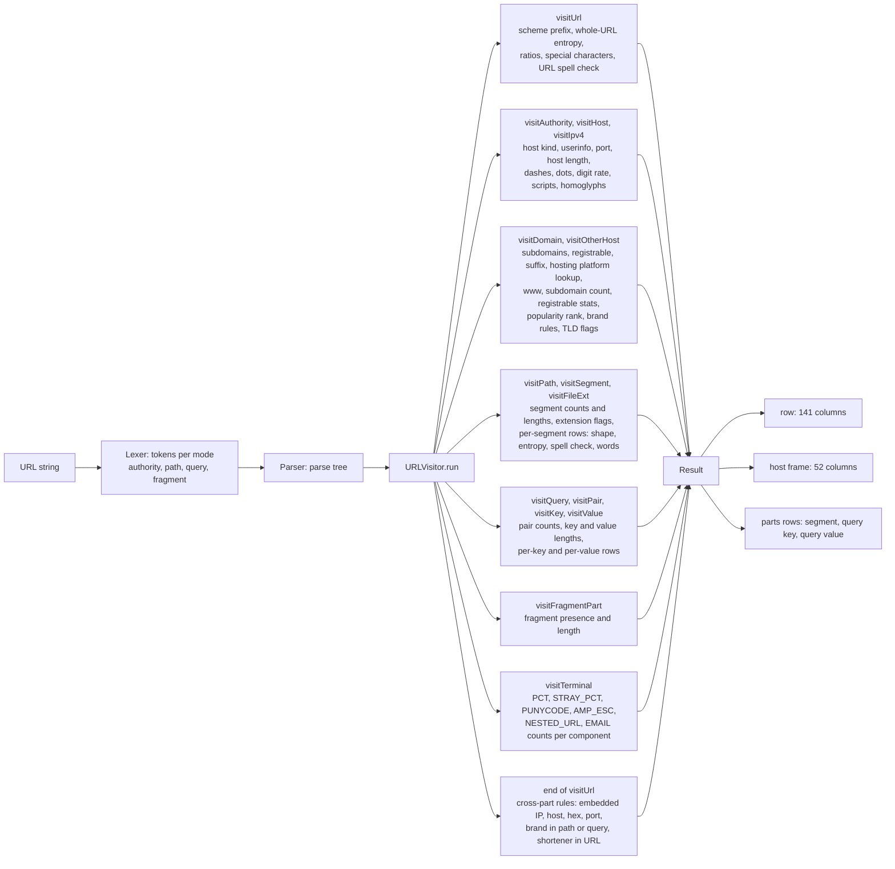

# URL-only phishing classifier

Task: `docs/task.md`. Report: `Report.md`. Data (`train.csv`, `test.csv`, `external_test.csv`) is **not** in the repo; put it in `data/`.

## Project setup
1. **Get the code and the data.** Clone the repository and copy the three supplied files into `data/` (they are not part of the repository):
   ```bash
   git clone <repository-url> phishing_ML && cd phishing_ML
   mkdir -p data && cp /path/to/{train,test,external_test}.csv data/
   ```
2. **Create the Python environment** (Python 3.14 was used; any 3.11 or newer should work). All versions are pinned in `requirements.txt`:
   ```bash
   python -m venv .venv && .venv/bin/pip install -r requirements.txt     # or: uv venv && uv pip install -r requirements.txt
   ```
   No Java and no network access are needed; the spell checker ships its dictionary and the trained model is in `src/models/results/` (the run named in `src/models/results/LATEST`).
3. **Optional, only to rebuild `Report.pdf`:** `pandoc` (3.6.4 used) and `xelatex` (TeX Live 2023 used).
4. **Check that it works** (a few seconds; it loads the saved model and runs 33 unusual inputs through `predict`):
   ```bash
   PYTHONPATH=src .venv/bin/python src/tests/test_predict_contract.py     # expected: "33 inputs, 0 failures"
   ```
5. **Reproduce everything** (about 30 minutes on a CPU; retrains the models, rescores both evaluation files, writes `deliverables/predictions.csv`, `Report.md` and `Report.pdf`):
   ```bash
   PYTHONPATH=src .venv/bin/python src/pipeline.py
   ```

Java is only needed to regenerate the ANTLR parser after editing the grammar (the ANTLR 4.13.2 jar is in `src/grammar/`):
`cd src/grammar && java -jar antlr-4.13.2-complete.jar -Dlanguage=Python3 -visitor -no-listener -Xexact-output-dir -o ../urlfeat/parser UrlLexer.g4 UrlParser.g4` (the word-list lexers: `cd src/grammar && ../../.venv/bin/python gen_words.py`).

## Using predict.py
`predict(url)` takes any raw string and returns exactly two keys: `label` (`"phishing"` or `"clean"`) and `probability` (a number between 0 and 1). It loads the saved model on first use; nothing is trained or downloaded.

**As a library** (the task's contract). All code lives in `src/`, so put it on the path:
```bash
PYTHONPATH=src .venv/bin/python
```
```python
>>> from predict import predict
>>> predict("https://www.wikipedia.org/")                                   # clearly legitimate
{'label': 'clean', 'probability': 0.012004801920768308}
>>> predict("https://docs.python.org/3/library/json.html")                  # clearly legitimate
{'label': 'clean', 'probability': 0.023952095808383235}
>>> predict("https://www.PayPal-secure.login.tk/webscr?cmd=x")              # clearly phishing (the task's example)
{'label': 'phishing', 'probability': 0.9978070175438597}
>>> predict("http://paypal.com.account-verify.secure-login.xyz/webscr/update.php?cmd=_login")   # clearly phishing
{'label': 'phishing', 'probability': 0.9978070175438597}
```
These are actual outputs of the delivered model (run `v3_20261109T0956_visitor-platform`). A URL is labelled phishing when its probability is above about 0.935 (1% of legitimate training URLs reach that score). The probability refers to a population that is half phishing, like the supplied data, not to real traffic. Invalid input (not a string, empty, longer than 8,192 characters, or not readable as a URL) returns `clean` with probability 0, meaning "no evidence", not "safe".

**From the command line** (`deliverables/predict.py`, works from any folder without setting `PYTHONPATH`): one JSON line per URL.
```bash
$ cd deliverables
$ ../.venv/bin/python predict.py "https://www.wikipedia.org/" "https://www.PayPal-secure.login.tk/webscr?cmd=x"
{"url": "https://www.wikipedia.org/", "label": "clean", "probability": 0.012004801920768308}
{"url": "https://www.PayPal-secure.login.tk/webscr?cmd=x", "label": "phishing", "probability": 0.9978070175438597}
```
Further options: `--vote URL` shows the vote of every model in the average, `--best URL` uses only the best single model, and `--test -n 50 --seed 1` scores a random sample of unseen URLs from a public dataset and saves the result to `deliverables/results/` (see `deliverables/README.md`).

## Commands
```bash
PYTHONPATH=src .venv/bin/python src/pipeline.py                # reproduce everything, about 30 min on CPU:
#   tests -> features -> train -> verify -> promote -> smoke -> evidence -> predictions -> report
#   (Report.md + Report.pdf, deliverables/predictions.csv, src/models/results/{runID}/, docs/report/*.json)
PYTHONPATH=src .venv/bin/python src/pipeline.py --only report  # rebuild Report.md / Report.pdf from the last run (after report-only edits)
PYTHONPATH=src .venv/bin/python -c "from predict import predict; print(predict('https://www.PayPal-secure.login.tk/webscr?cmd=x'))"
PYTHONPATH=src .venv/bin/python deliverables/predict.py "https://example.com/login"     # command-line wrapper
# single checks (all are also stages of the pipeline)
PYTHONPATH=src .venv/bin/python src/grammar/check_grammar.py         # grammar, word lexers and visitor assertions
PYTHONPATH=src .venv/bin/python src/tests/test_features.py           # one test per feature column on random URLs built from known components
PYTHONPATH=src .venv/bin/python src/tests/test_predict_contract.py   # predict() on invalid and unusual inputs
PYTHONPATH=src .venv/bin/python -m tools.check_visitor               # visitor vs the frozen earlier extractor (the tests stage builds the oracle if missing)
```
All Python code lives in `src/`; run it with `PYTHONPATH=src` (or `cd src`) so `from predict import predict` works. `src/predict.py` loads the latest run in `src/models/results/` (pointer file `LATEST`); nothing is trained or downloaded.

## Pipeline

Every URL is parsed once by ANTLR and visited once by `urlfeat.visitor.URLVisitor` (a child of the visitor generated from `UrlParser.g4`); that single visit builds the 141 full-URL columns, the host frame and the rows of the path segments / query keys / query values. No regular expressions: patterns are tokens of the grammars (`UrlLexer.g4`, the generated `Words*` word-list lexers) or scanners in `urlfeat/text.py`. Plan and decisions: `docs/plan_url_visitor.md`; equivalence with the previous extractor: `docs/analysis/visitor_agreement.md`.



### Where the visitor puts each kind of feature



## Layout
| path | what |
|---|---|
| `src/urlfeat/` | features: `visitor.py` (`URLVisitor`: one ANTLR visit builds the 141 columns, the host frame and the parts rows), `text.py` (regex-free scanners), `wordlists.py` (lookups + the generated word lexers), `readability.py` / `obfuscation.py` / `popularity.py` (pure helpers: spelling, look-alike characters, Tranco rank), `fingerprint.py`, `__init__.py` (re-exports the visitor's entry points `featurize`, `extract`, `tables`, `structure`). The visitor is the single entry point for parsing and feature building (column groups, host-label aggregates and the batch methods are in `visitor.py`; the other modules are pure helpers it imports) |
| `src/grammar/`, `src/urlfeat/parser/` | ANTLR grammars + `antlr-4.13.2-complete.jar` (same SHA-256 as url_grammar's), `gen_words.py` (word-list lexers from `src/lists/`), `check_grammar.py`; the generated Python lexers / parser / visitor (do not edit) |
| `src/lists/` | word lists; provenance in `CLAUDE.md` and in each file's header |
| `common.py` | cleaning, host grouping, paths |
| `src/models/model.py`, `src/models/run.py`, `src/models/parts_model.py`, `src/models/run_parts.py`, `src/pipeline.py` | the nine classifiers + search spaces; training / CV / importance / results writer; the parts model and its combination with the nine; the staged pipeline (features, train, verify) |
| `deliverables/` | `predict.py` CLI/library required by the task (`--test` runs 50 unseen URLs from a Kaggle dataset); see its README |
| `deliverables/predictions.csv` | `url,probability` for every `test.csv` row, written by calling `predict()` on each URL of the promoted run; `Report.md` is the report |
| `src/models/results/{runID}/` | metrics, feature importances, OOF predictions, config, deployable model |
| `src/predict.py`, `src/common.py` | single-URL prediction (`from predict import predict`); paths, host grouping, task normalisation |
| `src/tools/` | report and evidence tools (`data_report`, `report_numbers`, `evidence`, `write_predictions`, `build_report`, `build_report_pdf`), checks (`check_visitor`, `legacy_oracle` + the frozen `legacy_urlfeat`), analyses (`error_analysis`, `compare_runs`, `antlr_reliance`, `scheme_gap`, `collinearity`, `second_stage_experiment`, `feature_table`, `explain_url`, `export_parts`), data builders (`build_corpus`, `build_unseen_pool`, `score_u`) |
| `scripts/`, `logs/` | shell scripts; logs of earlier runs |
