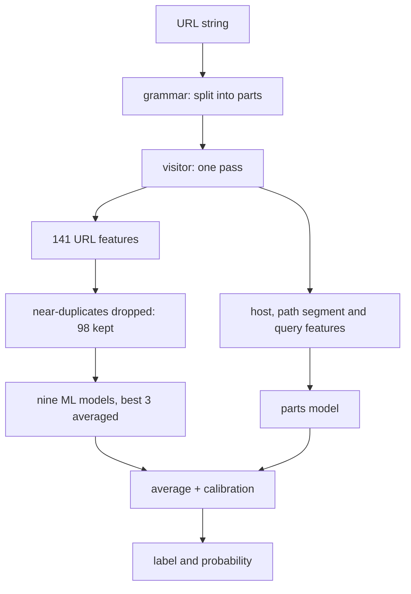

# Phishing detection from the URL: Results and Recommendation

## Overview
A machine learning pipeline has been built that judges a URL by its text, without visiting the page. It was trained on the supplied `train.csv` and 34,604 additional public URLs (43,255 URLs in total). It separates phishing from legitimate URLs, such ason websites it has never seen it reaches an AUC of 0.968, and on an independent collection 0.985. At the chosen threshold it catches 70% of phishing on the test set but only 51% on the independent collection, so its recall depends heavily on where the URLs come from.

## Pipeline Details
The core of the solution is an ANTLR grammar for URLs. ANTLR (Another Tool for Language Recognition) is a formal language design toolset with the options to generate lexers, parsers, listeners and visitors for target implementation languages. In this case, an elaborate URL parsing grammar was created with resources generated in Python. 
Every URL is read, lexed and parsed (scheme, host, path, query and fragment), and the *URLVisitor* walks through the AST (abstract syntax tree) of these parts and computes all 141 features along the way. The feature building design choice was that the ANTLR visitor bundles all feature building and parsing logic as a single source of feature extraction.
Each feature belongs to the part of the URL it describes, which makes every number traceable and easy to test, reflected by actual parsing grammar rules. Fixed vocabularies are part of the grammar or matched against whole parts of the host: the 1,549 official top-level domains are lexer tokens, and the 3,668 hosting platforms like `blogspot.com` are kept as a list that is matched against whole labels of the host.[if we used known lists, reference it here]
For instance, a host such as `cloud.google.com` is read correctly as the service `cloud` on the domain `google.com`, and all of the 14,367 supplied URLs are parsed correctly and not rejected by the specifically built grammar (0 rejected). Computing the features takes about 1.5 milliseconds per URL.

The actual pipeline is shown on the following graph:

The parts model looks at a URL as a set of pieces rather than as one row of numbers. During the same pass, the visitor also describes the host on its own and every path segment, query key and query value separately. Three XGBoost models score these pieces: one for hosts, one for path segments and one for query keys and values. Because a URL can have any number of segments and parameters, their scores are summarised per URL by the mean, the highest and the lowest score, so that a single suspicious piece can raise the result. A logistic regression then combines the host score with these summaries into one probability. All parts are trained so that a URL is never scored by a model that saw its own website.

As an explainable baseline, a logistic regression was trained. It reached an AUC of 0.943 on the test set and 0.968 on the independent collection.
The final solution averages three scores: an XGBoost model, the average of the three best of nine classifiers (XGBoost, MLP, random forest), and a *parts model* that scores the host, every path segment and every query parameter separately and then combines them. The parts model was added because the URL-level models summarise a whole URL in one row and make their mistakes where both classes look alike; judging each piece on its own leads to different mistakes, so the average is more robust on a new source. On its own it is weaker (0.967 AUC in cross-validation), but adding it left the cross-validated AUC unchanged and changed it by +0.010 on the independent collection. This combination lifted the AUC to 0.980 on the test set and 0.985 on the independent collection.

## The data
The training file has 8,651 rows, about half of them phishing. It has not been cleaned: 80 rows repeat a URL that already appeared, and 50 URLs appear once as phishing and once as legitimate. A handful of websites also dominate the file; `blogspot.com`, `duilawyeryork.com` and `appspot.com` alone account for 755 rows. The file was kept as supplied, but was always validated with whole websites held out, so that the same site, or a duplicate of a URL, can never sit on both sides of a test. Without this, our validation would have looked 0.004 AUC better than it really is.

To widen the training data, 34,604 URLs from 8 public collections were added to `train.csv` (4 times its size, half of them phishing): Ebbu2017, several Kaggle phishing datasets, public phishing feeds, a Common Crawl sample and Tranco homepages (collected by `src/tools/build_corpus.py`; the sources are listed in `CLAUDE.md`). Every URL that also appears in `test.csv` or `external_test.csv` under the task's normalisation was removed beforehand (21,774 rows), and a second check while sampling found 0 left. The model was therefore trained on 43,255 URLs. Compared on identical URLs with the same pipeline trained on `train.csv` alone, the AUC on the independent collection rose from 0.957 to 0.985 (95% interval +0.022 to +0.037), on the test set it moved from 0.982 to 0.980 (95% interval -0.005 to +0.001), and in cross-validation on the `train.csv` rows it went from 0.971 to 0.964. The extra data therefore helps most on a new source and costs a little on data like `train.csv`. Part of the gain may come from the public sources resembling the independent collection: 23% of its rows now sit on a website seen in training, against 10% with `train.csv` alone.

## Model Performance
The threshold decides when a score counts as phishing. It was set using the training data only: every training URL was scored by a model that had not seen its website, and the threshold was placed so that only 1% of the legitimate training URLs score above it. In other words, we accept that about one legitimate URL in a hundred is flagged, and the recall is whatever the model achieves at that point. A stricter threshold would flag fewer legitimate URLs but also catch less phishing; 1% was fixed in advance, before the evaluation files were scored. The table shows how the model performs at that threshold; the ranges in brackets are 95% intervals.

| data | AUC | phishing caught (recall) | legitimate flagged (false-positive rate) | flagged that are phishing (precision) |
|---|---|---|---|---|
| training, cross-validated | 0.981 [0.977-0.984] | 71.4% | 1.0% | 98.6% |
| test set | 0.980 [0.972-0.987] | 70.1% [65.0-75.0%] | 0.6% [0.1-1.0%] | 99.2% |
| independent collection | 0.985 [0.980-0.989] | 50.9% [43.9-56.7%] | 0.1% [0.0-0.2%] | 99.9% |

About half of the test set rows (52%) come from websites that also appear in training, and on those the model scores an AUC of 0.987, compared with 0.968 on websites it has not seen. We measured the overlap in several ways, from the strict to the loose:

| two URLs count as the same when they have ... | share of test rows | share of independent rows |
|---|---|---|
| the identical string | 0.0% | 0.0% |
| the same text after the task's rule (case, scheme, `www.`, trailing slash) | 5.1% | 0.0% |
| the same page when the query string is also ignored | 9.8% | 0.1% |
| the same host and the same first folder of the path | 26.7% | 1.9% |
| the same website (registrable domain) | 51.7% | 22.9% |

The task's own rule for "the same page" misses pages that differ only in a query string, an ID number or a mirrored host name; the looser rows of the table show how much that adds. All 146 matching test rows carried the training label.

The independent collection shares no page with the training data and only 23% of its rows come from websites seen in training, which makes it the better guide to new traffic. On it, at our fixed threshold the model catches 51% of phishing, while a threshold set on this collection itself would catch 77% at the same 1% false-alarm rate. The most likely reason is that every legitimate URL in it is a bare homepage (all use https and `www`, and none has a path), which looks quite different from the legitimate URLs we trained on.

**URL normalisation.** The task's rule for "the same page" (lower-case, no scheme, no leading `www.`, no trailing slash) is not a preprocessing step of the delivered pipeline: the scheme and `www` carry information, and URLs are never rewritten. As an option, the visitor can compute every feature on that normalised view instead (`URLVisitor(normalised=True)`, `pipeline.py --normalised`), so that URLs which differ only in these respects get identical features; this was checked on all supplied URLs. The spelling does matter to a model trained on URLs as given: for the delivered model, adding or removing `www.` changes the label of 13.7% of 300 sampled test URLs and 13.3% of independent ones, and reducing a URL to the task's form changes 10.0% and 15.3%. The option was tested on `train.csv` with the same folds: cross-validated AUC was lower for 9 of the 9 models (XGBoost 0.969 to 0.963, logistic regression 0.956 to 0.942), so it was not adopted. The delivered model reads every URL as given.

## Data Insights
Phishing URLs often live on free hosting platforms: 13.9% of the phishing URLs in training do, against 2.7% of legitimate ones. They also more often contain a second domain name inside the URL (8.8% against 0.8%) or a typical phishing word such as "login" or "verify" (25% against 2.7%).

The presence of a path depends more on the data source than on phishing itself. Most legitimate URLs in training and test have a path (62% and 60%), but none of those in the independent collection do. This hurts: the model catches only 51% of phishing URLs without a path on the test set, against 75% of those with one.

**Same website, both labels.** 125 websites in the training data carry both phishing and legitimate URLs (8% of the rows), and so do 5 in the test set (mostly `blogspot.com`, `google.com`, `tumblr.com`). On these rows the model is clearly weaker: out of fold the AUC is 0.921 against 0.985 on the other websites, and on the test set 0.858 against 0.984. Of two URLs from the same website, the phishing one is scored higher in 90% of the pairs in training and 84% on the test set. These websites produce 39% of the false alarms in training (and 25% on the test set). The model largely gives one verdict per website: on websites such as `blogspot.com`, `duilawyeryork.com`, `appspot.com` many of the legitimate URLs are flagged, while on large popular domains such as `youtube.com`, `facebook.com`, `google.com`, `yahoo.com`, `wordpress.com` not one phishing URL is caught. 50 pages appear in training with both labels; 90% of them are the identical URL, which no URL-based model can separate. The conclusion is that the model judges the website far better than the individual page; telling pages apart within one website needs features of the sub-domain and path that do not depend on the website (one site per platform tenant, character patterns of the path), and a missing alert on a popular domain should not be read as "safe".

One common belief did not hold up. We expected phishing to hide on unknown domains, and in training that is true: 39% of legitimate URLs but only 13% of phishing URLs sit on a domain from the 50,000 most popular websites. In the independent collection the picture reverses, with 6.9% against 11.1%. Domain popularity is nevertheless the model's strongest feature, so part of what the model learned is specific to how these collections were put together. These are patterns of these datasets, not general rules about phishing.

## Threshold and Deployment
To estimate how the model would do in practice, we assumed that one URL in a thousand is phishing and that the detection and false-alarm rates measured on the test set carry over to real traffic. We cannot verify the second assumption, because neither evaluation file is a sample of real traffic. Under these assumptions, only about 11.1% of the URLs the model flags would actually be phishing (somewhere between 6.5% and 32.0%). On the independent collection 1 of 1,429 legitimate URLs was flagged (a false-alarm rate of 0.07%), which at that prevalence means about 42% of alerts would be phishing; with so few false alarms the range is wide (19% to 100%).

The evaluation sets are too small to pin down the false-alarm rate more precisely than within a factor of about 7, and at a prevalence of one in a thousand that rate decides almost everything. Blocking is therefore not justified. A warning to the user, or a ranking that sends the most suspicious URLs to a reviewer first, is a reasonable use. Before a wider rollout we would need a labelled sample of real incoming URLs (tens of thousands of legitimate ones), an evaluation on later data than the training data, and an agreement on what a missed phishing URL costs compared with a wrongly flagged one.

The function `predict(url)` returns a label and a probability. The probability is calibrated for a population that is half phishing, like our data, not for real traffic, where the true chance is far lower; it also shifts on other sources. Inputs that cannot be read as a URL (not text, empty, longer than 8,192 characters, or rejected by the grammar) return "clean" with probability 0, which means "no evidence", not "safe". A URL is labelled phishing when its returned probability is above about 0.944.

## Key Decisions

| observation | action | effect |
|--------------|-----------|--------------------|
| The same few websites fill many rows of the training file. | We validated with whole websites held out. | A random split would have overstated the AUC by 0.004 (0.983 instead of 0.979). |
| Hosting-platform names inside the grammar split real host names, for example `com.secureupdate` into `com.se` and `cureupdate`. | We moved the platform names into a list that is matched against whole parts of the host. | 185 training URLs now get correct host features. |
| The remaining errors sit where both classes look alike in the URL-level features. | We added the parts model, which scores each part of the URL separately, to the delivered average. | AUC changed by 0.000 in cross-validation, 0.000 on the test set and +0.010 on the independent collection. |
| The independent collection looks unlike `train.csv`, and the model's recall there was low. | We added 34,604 public URLs to the training data. | Independent AUC +0.029 (95% interval +0.022 to +0.037), test AUC -0.002, cross-validated AUC on the `train.csv` rows -0.007. |
| The same page written with or without `www.` could get a different label. | We tried computing all features on the task's normalised view of the URL. | Cross-validated AUC fell for every model (XGBoost -0.006), so the option was not adopted. |

## Limitations and next steps
The data has no dates, so we could not test whether the model holds up over time. The added public data may resemble the independent collection more than real traffic does. The strongest features, domain popularity and the `www` prefix, depend on how the collections were built. Some choices were made with the full training file in view (the removal of near-duplicate features), and the averaging of three models was chosen after earlier runs had shown their external scores, so the independent collection is not completely untouched. Not done yet: a model on the raw characters of the URL (an earlier version of it improved the independent results), adjusting the model to the real share of phishing, a variant that relies less on source-specific signals, and features that separate pages within one website (see the same-website analysis above).
